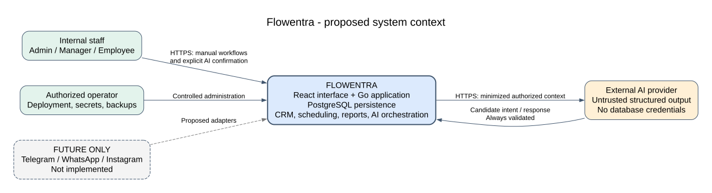
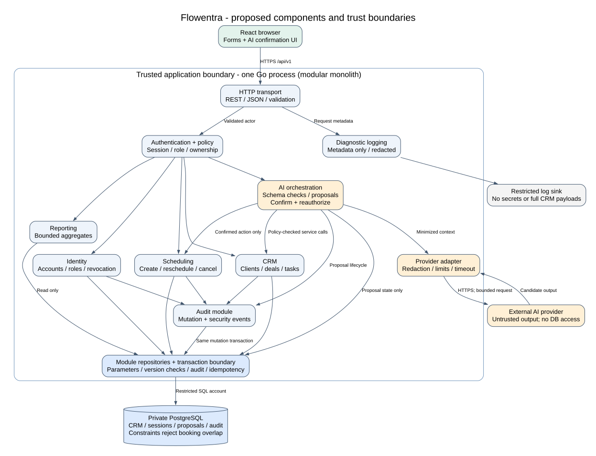

# Flowentra: System Architecture

Task: **PD-03** | Responsible student: **Aitzhan Iliyas**

Status: **proposed architecture, not an implemented or deployed system**. Depends conceptually on the PD-01 scope and PD-02 technology decisions; both require independent review. This task adds only architecture and diagram files to the clean baseline.

## 1. Scope and architectural drivers

Flowentra targets one organization per deployment. Its internal users have fixed `admin`, `manager`, or `employee` roles. Clients are CRM records, not portal accounts. The planned stack is React, a Go REST/JSON backend, and PostgreSQL. The backend must enforce ownership, atomic mutations, retry safety, and employee appointment exclusivity. The optional AI provider is outside the trusted application boundary.

This design serves a small diploma team with limited operational scope. There is no deployed backend, database migration, frontend prototype, or AI service demonstrated by these diagrams. Aibek's new frontend prototype is planned under PD-10; the user confirmed that no current prototype URL is available.

## 2. System context



Editable source: [01_System_Context.dot](../diagrams/01_System_Context.dot). PNG export: [01_System_Context.png](../diagrams/01_System_Context.png).

The context diagram treats Flowentra as one system. Internal staff use its browser interface. An external AI provider receives only the request context that the backend has minimized and authorized. An operator handles configuration, secrets, backups, and deployment. Telegram, WhatsApp, and Instagram appear as dashed future boundaries, not active interfaces. Clients have no direct system access in this MVP.

## 3. Modular monolith and component boundaries



Editable source: [03_Component_Diagram.dot](../diagrams/03_Component_Diagram.dot). PNG export: [03_Component_Diagram.png](../diagrams/03_Component_Diagram.png).

One Go application process contains modules with explicit service interfaces. Modules are code boundaries, not separately deployed services. They share a PostgreSQL database and transaction coordinator. No service mesh, event broker, distributed transaction protocol, or internal HTTP calls are required for the MVP.

| Component | Owns | Interaction and restriction |
| --- | --- | --- |
| React web client | Forms, navigation, validation feedback, timezone display, AI proposal confirmation | Calls `/api/v1`; browser checks improve UX but never authorize an operation |
| HTTP transport | Route binding, JSON decoding, size limits, correlation IDs, response encoding | Rejects unknown fields and malformed inputs; delegates business decisions |
| Authentication and policy | Session validation, fixed roles, current account state, ownership decisions | Actor comes from the validated session, never from a submitted role or model output |
| Identity module | Internal accounts, roles, session revocation | Admin-only account mutations; prevents removal of the last active admin |
| CRM module | Clients, deals, tasks, assignment and transition rules | Shared client directory; employee deals/tasks scoped to self; manager/admin may access all |
| Scheduling module | One employee/client per appointment, UTC intervals, cancellation | Checks business rules and relies on a database exclusion constraint for concurrency |
| Reporting module | Bounded summary queries | Manager/admin only; returns aggregates, not arbitrary SQL execution |
| AI orchestration | Intent parsing, allowed context retrieval, schema checks, proposal lifecycle | Calls policy-protected services; has no generic database query or network-fetch tool |
| AI provider adapter | Provider request/response translation, limits, timeouts | Holds server-side credentials; provider gets neither DB credentials nor user sessions |
| Persistence and transaction boundary | Parameterized queries, migrations, transactions, version checks | No SQL in controllers or model-produced query text; module repositories remain internal |
| Audit module | Actor/action/object/result metadata for mutations and security events | Business audit writes share the mutation transaction; failed audit persistence rolls back writes |
| Diagnostic logging | Request ID, route template, duration, status, error category | Redacts secrets and personal payloads; access restricted to operators |

The intended package structure is `cmd/server` and `internal/{transport,identity,policy,crm,scheduling,reporting,ai,audit,store}`. These paths describe a future implementation; no source tree is claimed to exist. Public service methods accept a validated actor/context. Calling a service from the AI module must execute the same policy as calling it from an HTTP handler.

## 4. Data ownership and persistence

The conceptual records are users, sessions, clients, deals, tasks, appointments, audit events, idempotency records, and AI proposals. UUIDs identify records; fixed role values are not user-editable roles. Deal values use exact decimal storage with one configured deployment currency. Timestamps are UTC instants with explicit display timezone metadata for appointments.

Foreign keys preserve relationships. Client archiving preserves history and blocks new related business records. User deactivation revokes sessions and blocks new assignment; existing records are retained for manager reassignment. Employee-scoped queries filter in SQL before pagination; single-record lookups use the same scope. The application must not load all records and rely on React or the model to hide unauthorized rows.

The shared-client-directory policy is intentional and must be confirmed by the team. It does not imply shared access to every deal, task, or appointment attached to a client. There is no implicit tenant ID supplied by callers because the MVP is one organization; future multi-tenancy requires a reviewed redesign of all keys, policies, storage, and tests.

## 5. Principal request flows

### 5.1 Login and authenticated work

1. The browser submits credentials over HTTPS. There is no public registration.
2. The server applies login rate limits, verifies a password hash, checks account status, and creates a revocable opaque session.
3. The browser stores the short-lived bearer token in memory. Reload requires login in this bounded MVP; tokens are not stored in local storage or URLs.
4. Middleware resolves the current actor for each request. Service policy checks roles and ownership before accessing records.
5. Logout revokes the current session. Deactivation and role changes revoke the affected user's sessions. PD-04 defines the detailed contract.

### 5.2 Appointment creation

1. The actor submits a client, employee, explicit-offset start/end times, display timezone, and idempotency key.
2. Policy checks the actor may book that employee; reference checks require active client and user records.
3. A short transaction obtains the idempotency record, locks/checks relevant reference state, inserts the appointment, appends its audit event, and records the response.
4. A PostgreSQL exclusion constraint rejects overlapping active intervals for the same employee, including competing requests. A prior availability lookup is advisory only.
5. The server returns the committed resource, or a standardized conflict. The same service handles confirmed AI proposals.

### 5.3 Safe AI action

1. A signed-in employee asks to create a follow-up task. The server retrieves only permitted CRM context, with limits and redaction.
2. The provider returns a proposed structured intent, not executable code. The orchestrator validates it against an allowlist and resolves references.
3. The server stores an immutable, expiring proposal bound to the actor, exact arguments, and relevant resource versions. React displays a plain-language summary generated from those validated fields.
4. The actor explicitly confirms that proposal. The server rechecks current account status, permissions, target state, and versions.
5. A short transaction consumes the proposal once and performs the allowed mutation through the normal business service, including audit and idempotency. Stale, denied, or expired proposals make no change.

No database transaction remains open during a provider call or while waiting for human confirmation. Detailed proposed AI contracts and threat cases belong to PD-05; public AI endpoints are deliberately not claimed as part of PD-04's core API.

## 6. Transactions, consistency, and failure boundaries

| Boundary | Proposed behavior |
| --- | --- |
| Single business mutation | Business row, audit event, and successful idempotency result commit atomically |
| Concurrent update | Numeric resource version becomes a strong ETag; mandatory `If-Match` prevents lost updates |
| Booking race | Database exclusion constraint wins; map conflict to HTTP 409 without leaking another client's details |
| Referenced account/client changes | Coordinate row locks so a create cannot pass an active-state check while deactivation/archive commits first |
| Reporting snapshot | Bounded query set in a consistent read-only transaction; no AI interpretation required for counts |
| External provider | Deadline, bounded input/output, no transaction, and no automatic retry of a committed CRM action |
| Unknown mutation outcome | Reuse the same idempotency key; never issue an unrelated duplicate create |
| Database or audit write failure | Roll back mutation and return a retryable server error; do not report success |

The lock order and HTTP mappings must be made explicit in PD-04. A modular monolith simplifies transaction management but does not automatically make every operation atomic or secure.

## 7. Security, privacy, and operations

HTTPS terminates at a configured ingress or reverse proxy. The database is on a private interface and is reachable only by the application and authorized operators. The application uses a restricted database account; migrations use a separate controlled account. Secrets are provided through deployment configuration and excluded from Git. CORS is restricted to the configured frontend origin; bearer tokens are not automatically attached cross-site as cookies would be.

Passwords, session tokens, provider keys, full prompts, and complete CRM records must not enter ordinary logs. Audit records contain actor, action, object identifier, correlation ID, timestamp, outcome, and a minimal field-change description. Operators control audit access and retention. The proposed demo uses synthetic data; retention, provider processing terms, and legal requirements need approval before real personal data is used.

A provider outage disables assistant requests and shows the manual forms. A database outage prevents writes and produces an explicit unavailable response. A failed backup/restore check blocks readiness claims. Health probes, migrations, secret handling, deployment configuration, backup/restore scripts, and monitoring remain implementation work, not delivered capabilities.

## 8. External services and deferred integrations

Only a provider-neutral AI boundary is proposed for the MVP; no vendor is selected or configured here. The React browser must never call the provider directly with a service key. Telegram, WhatsApp, Instagram, outbound email, payment processors, and calendar synchronization are future extensions. The diagram's dashed channel edges are intentionally non-operational. Each channel would need separate identity binding, webhook verification, replay protection, permissions, confirmation design, and platform review.

## 9. Decisions, alternatives, and traceability

| Decision | Reason | Consequence / reconsideration trigger |
| --- | --- | --- |
| Modular monolith | Shared transactions, single deployment, small team | Extract a service only with measured operational or ownership need |
| PostgreSQL relational core | CRM relationships and enforceable interval exclusion | Booking design depends on PostgreSQL features; verify extension availability |
| REST/JSON with OpenAPI | Bounded browser workflows and inspectable contract | Specialized summary endpoints may be needed to limit round trips |
| Revocable opaque sessions | Immediate current-state authorization and simple revocation | Requires a session lookup; token refresh and federated identity deferred |
| Human-confirmed AI mutations | Prevent model output from becoming authority | Additional interaction; tests must cover stale/replayed confirmations |
| Single organization | Keeps the diploma scope bounded | No claim of SaaS tenant isolation |

PD-01 objectives map to the architecture as follows: OBJ-01 to module/API boundaries; OBJ-02 to CRM persistence; OBJ-03 to authentication and policy; OBJ-04 to scheduling constraints; OBJ-05 to the AI boundary; OBJ-06 to isolated task PRs. PD-02 supplies technology reasoning. PD-04 supplies core endpoint and transaction contracts. PD-05 supplies AI threat controls. Changes to an upstream decision require an explicit consistency review before merging dependent PRs.

## 10. Diagram reproduction and verification

Both DOT sources are authoritative editable diagrams. With Graphviz installed, run from the repository root:

```sh
dot -Tsvg diagrams/01_System_Context.dot -o diagrams/01_System_Context.svg
dot -Tpng diagrams/01_System_Context.dot -o diagrams/01_System_Context.png
dot -Tsvg diagrams/03_Component_Diagram.dot -o diagrams/03_Component_Diagram.svg
dot -Tpng diagrams/03_Component_Diagram.dot -o diagrams/03_Component_Diagram.png
```

For this task, Graphviz's WebAssembly distribution through `@viz-js/viz` 3.17.0 is used to render the same DOT sources, with `sharp` 0.34.5 converting SVG to PNG. Local verification tools stay outside the task branch. Exports must be visually inspected for readable labels, unambiguous boundaries, and absence of a model-to-database edge. The PR records observed checks; these checks are not runtime architecture tests.

## 11. References and limitations

- PostgreSQL, [Range Types and exclusion constraints](https://www.postgresql.org/docs/18/rangetypes.html), supports the proposed booking integrity approach.
- IETF, [HTTP Semantics, RFC 9110](https://www.rfc-editor.org/rfc/rfc9110.html), conditional requests and method behavior.
- OWASP, [LLM application risk guidance](https://genai.owasp.org/llm-top-10/), supports treating model output and retrieved content as untrusted.

References consulted on 2026-10-23. The module decomposition is an original project design judgment prepared with AI assistance, not a copied implementation. No content was restored from the old draft. Student verification, independent architecture review, database tests, frontend agreement, deployment evidence, and real security validation remain outstanding.
